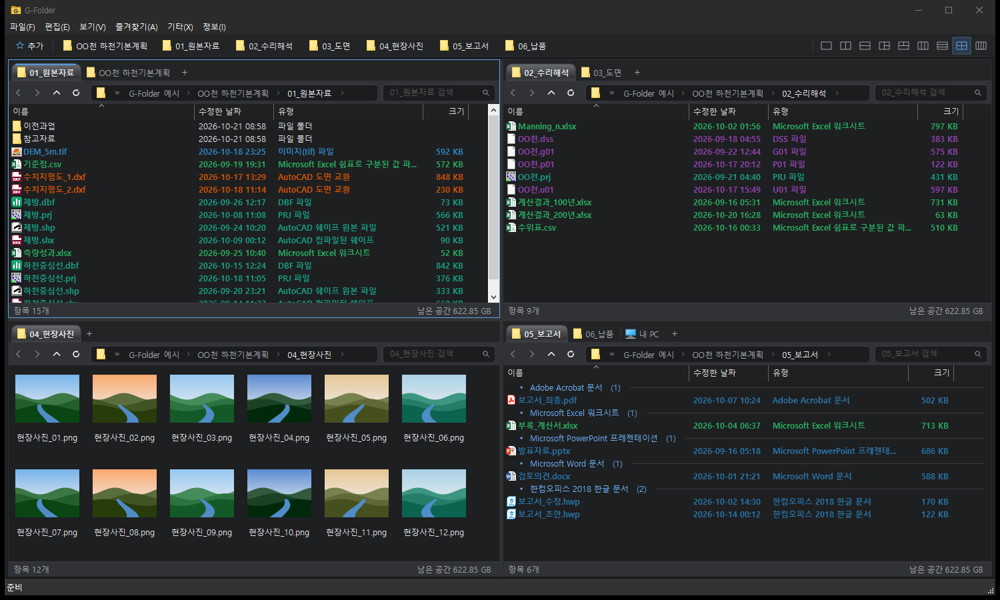

# G-Folder

**한 화면에서 폴더 여러 개를 나란히 보는 Windows용 다중 창 파일 관리자**
Q-Dir처럼 화면을 2~4개로 나누고, 창마다 탭을 열어 탐색기보다 빠르게 파일을 옮기고 정리할 수 있습니다. 무료입니다.

<!-- 캡처 1: 4분할 전체 화면 (어두운 테마) -->

---

## 주요 기능

**창 · 탭**
- 1·2·3·4분할 등 9가지 창 배치, 창 크기 똑같이 맞추기
- 창마다 여러 탭, 탭을 끌어 순서 변경 / 다른 창으로 이동 (Ctrl = 복사)
- 닫은 탭 다시 열기 (Ctrl+Shift+T), 탭이 많으면 `<` `>`로 탭 목록 이동
- 즐겨찾기 막대 (폴더를 끌어다 놓으면 추가)

**파일 작업**
- 윈도우 탐색기와 같은 우클릭 메뉴 (압축 프로그램, 연결 프로그램 등 그대로)
- 복사·잘라내기·붙여넣기가 탐색기와 서로 호환, 실행 취소(Ctrl+Z)
- 끌어다 놓기: 같은 드라이브 = 이동, 다른 드라이브 = 복사 / 오른쪽 버튼으로 끌면 메뉴
- ArcMap, 메모장 등 다른 프로그램으로도 끌어다 놓기 가능
- 여러 파일 한꺼번에 이름 바꾸기 (F2), 폴더 크기 계산, 파일 목록 CSV 내보내기

**보기**
- 아주 큰 아이콘(사진 미리보기) ~ 자세히, Ctrl+휠로 크기 조절
- 이름·날짜·유형·크기로 정렬 / 분류, **폴더마다 정렬 방식 기억** (복사·이동해도 따라감)
- 확장자·이름 조건으로 글자 색 바꾸기 (색상 규칙)
- 어두운 / 밝은 테마
- 숨긴 항목 표시, 보호된 운영 체제 파일 숨기기

**편의 기능**
- 사진을 열면 윈도우 사진 앱에서 좌우로 다음 사진 넘기기
- 주소창에 `cmd`, `wsl`, `powershell`을 입력하면 지금 폴더에서 실행
- 폴더 안 검색(필터), 글자 입력으로 바로 이동
- 탐색기 폴더 우클릭에 "G-Folder로 열기" 추가 (설치할 때 선택)
- 폴더 내용이 바뀌면 자동 새로 고침

<!-- 캡처 2: 탭 여러 개 + 우클릭 메뉴 -->
<!-- 캡처 3: 큰 아이콘 보기(사진 미리보기) -->

---

## 설치

1. [**G-Folder_Setup.exe 다운로드**](https://github.com/SEOGEON-rjs/G-Folder/releases/latest/download/G-Folder_Setup.exe)
2. 받은 파일을 실행합니다. 관리자 권한은 필요 없습니다.
3. 새 버전이 나오면 프로그램을 켤 때 알려 줍니다. 받은 설치 파일을 그대로 실행하면 설정은 유지한 채 업데이트됩니다.

**지원 환경:** Windows 10 / 11 (64비트)

### "Windows의 PC 보호" 창이 뜰 때

G-Folder는 개인이 만든 프로그램이라 아직 코드 서명이 없습니다. 그래서 처음 실행하면 아래와 같은 경고가 뜰 수 있습니다.

- **Windows의 PC 보호** 창 → **추가 정보** → **실행**
- 브라우저에서 다운로드가 막히면 → 다운로드 목록의 **…** → **유지** → **그래도 유지**

바이러스가 아니라, 다운로드 수가 적은 새 프로그램이면 일단 막는 Windows 기능입니다.

---

## 단축키 (일부)

| 키 | 동작 |
|---|---|
| Tab / Shift+Tab | 다음 창 / 이전 창 |
| Ctrl+T / Ctrl+W | 새 탭 / 탭 닫기 |
| Ctrl+Shift+T | 닫은 탭 다시 열기 |
| Backspace, Alt+↑ | 상위 폴더 |
| Ctrl+L | 주소창 |
| Ctrl+F | 폴더 안 검색 |
| F2 | 이름 바꾸기 |
| Ctrl+Shift+N | 새 폴더 |
| Ctrl+Z | 실행 취소 |

전체 단축키는 프로그램의 **정보 → 단축키 안내**에서 볼 수 있습니다.

---

## 개인정보 안내

G-Folder는 버전 안내와 사용 현황 집계를 위해, 실행·종료할 때와 실행 중 일정 간격으로 아래 정보를 제작자의 서버(Google Apps Script)로 보냅니다.

- 프로그램 버전, Windows 버전
- PC 이름, Windows 사용자 이름

파일 이름, 폴더 내용, 열어 본 경로 같은 정보는 **보내지 않습니다.**

---

## 문의 · 버그 신고

- 버그나 기능 요청은 [Issues](https://github.com/SEOGEON-rjs/G-Folder/issues)에 남겨 주세요.
- 가능하면 화면 캡처와 함께, 어떤 순서로 했을 때 생기는지 적어 주시면 빨리 고칠 수 있습니다.

## 후원

G-Folder는 무료입니다. 도움이 되셨다면 후원으로 응원해 주세요. 개발에 도움이 됩니다. 후원에 감사드립니다.

- 카드 / PayPal: [ko-fi.com/gfolder](https://ko-fi.com/gfolder)

---

### English

**G-Folder** is a free multi-pane file manager for Windows (like Q-Dir): split the window into 1–4 panes, open tabs in each pane, and move files between folders quickly. It uses the native Explorer context menu and clipboard, so it works alongside Windows Explorer.

- [Download G-Folder_Setup.exe](https://github.com/SEOGEON-rjs/G-Folder/releases/latest/download/G-Folder_Setup.exe) (Windows 10/11, 64-bit; the UI is Korean)
- If Windows SmartScreen appears: **More info → Run anyway** (the app is not code-signed yet).
- G-Folder sends the app version, Windows version, PC name and Windows user name to the author's server for update notices and usage statistics. No file names or folder contents are sent.
- Support: [ko-fi.com/gfolder](https://ko-fi.com/gfolder)
