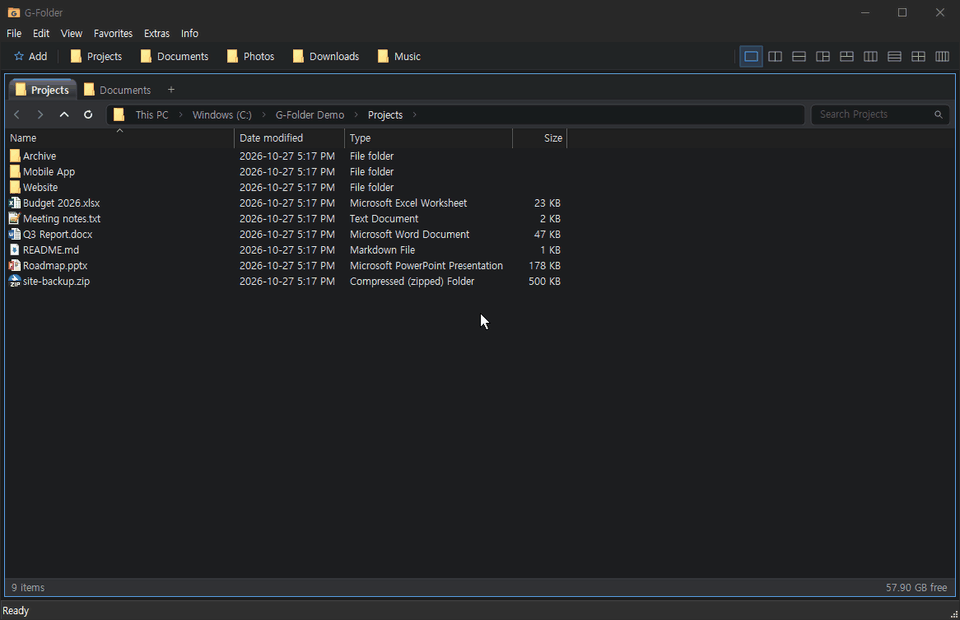

# G-Folder

**A free multi-pane file manager for Windows — see several folders side by side.**
Split the window into 1–4 panes like Q-Dir, open tabs in each pane, and move files between folders faster than with File Explorer.

**Languages:** English · 한국어 (choose during setup, or later in *Extras → Language*) — [한국어 설명은 아래에 있습니다 ↓](#한국어)

---

## Features

**Panes & tabs**
- 9 pane layouts (1, 2, 3 or 4 panes), one click to make all panes the same size
- Multiple tabs per pane — drag a tab to reorder it or move it to another pane (hold **Ctrl** to copy)
- Drag a tab outside G-Folder to open that folder in File Explorer at the drop position
- Reopen closed tabs (Ctrl+Shift+T), favorites bar (drop a folder on it to add)

**File operations**
- The real Windows Explorer context menu (archivers, "Open with", etc. just work)
- Copy / cut / paste are compatible with File Explorer, with undo (Ctrl+Z)
- Drag & drop: same drive = move, other drive = copy; right-drag shows a menu
- Batch rename (F2), folder size calculation, export a file list to CSV

**View**
- Extra large icons (photo thumbnails) to Details, Ctrl+Wheel to zoom
- Sort and group by name, date, type or size — **sort order is remembered per folder**
- Color filters: change text color by extension or name (Q-Dir color filter files can be imported)
- Dark / light theme, hidden items, hide protected OS files

**Handy extras**
- Open a photo and flip to the next/previous one in the Windows Photos app
- Type `cmd`, `wsl` or `powershell` in the address bar to open it in the current folder
- Filter the current folder, jump by typing letters
- Optional "Open with G-Folder" in the File Explorer right-click menu
- Auto-refresh when folder contents change

---

## Install

1. [**Download G-Folder_Setup.exe**](https://github.com/SEOGEON-rjs/G-Folder/releases/latest/download/G-Folder_Setup.exe)
2. Run it — no administrator rights needed. Pick **Language: English** at the bottom-left of the setup window.
3. G-Folder tells you when a new version is available. Running the new setup keeps your settings.

**Requirements:** Windows 10 / 11 (64-bit)

### If Windows SmartScreen appears

G-Folder is made by an individual developer and is not code-signed yet, so Windows may warn you the first time.

- **Windows protected your PC** → **More info** → **Run anyway**
- If your browser blocks the download → **…** in the downloads list → **Keep** → **Keep anyway**

---

## Keyboard shortcuts (selection)

| Key | Action |
|---|---|
| Tab / Shift+Tab | Next / previous pane |
| Ctrl+T / Ctrl+W | New tab / close tab |
| Ctrl+Shift+T | Reopen closed tab |
| Backspace, Alt+↑ | Parent folder |
| Ctrl+L | Address bar |
| Ctrl+F | Filter the current folder |
| F2 | Rename |
| Ctrl+Shift+N | New folder |
| Ctrl+Z | Undo |

See **Info → Keyboard shortcuts** in the app for the full list.

---

## Privacy

To show update notices, stop versions with known problems and count usage, G-Folder sends the following while it is running:

- a **random installation ID** (e.g. `GF-7K3Q-9XMA-2PDR`) — not linked to your name, PC name or Windows account
- program name and version, Windows version
- start / exit times and an "in use" signal every 10 minutes
- license key (licensed edition only)

Your PC name, Windows account name, file or folder names and contents are **never** sent.
Data is stored in Google Sheets. The full notice is shown during setup ([PRIVACY.md](PRIVACY.md)).
To have your data deleted, open an [issue](https://github.com/SEOGEON-rjs/G-Folder/issues) with your installation ID (*Info → About G-Folder → Open settings folder* → `G-Folder.id`).

---

## Feedback & bug reports

- Please use [Issues](https://github.com/SEOGEON-rjs/G-Folder/issues). A screenshot and the steps to reproduce help a lot.

## Support

G-Folder is free. If it helps you, you can support development on [Ko-fi](https://ko-fi.com/gfolder). Thank you!

---

## 한국어

**한 화면에서 폴더 여러 개를 나란히 보는 Windows용 다중 창 파일 관리자입니다.** Q-Dir처럼 화면을 2~4개로 나누고, 창마다 탭을 열어 탐색기보다 빠르게 파일을 옮기고 정리할 수 있습니다. 무료입니다.

- [**G-Folder_Setup.exe 다운로드**](https://github.com/SEOGEON-rjs/G-Folder/releases/latest/download/G-Folder_Setup.exe) — Windows 10 / 11 (64비트), 관리자 권한 필요 없음
- 설치 화면 왼쪽 아래에서 언어(한국어 / English)를 고를 수 있고, 설치 후에는 **기타 → 언어 (Language)** 에서 바꿀 수 있습니다.
- 새 버전이 나오면 프로그램을 켤 때 알려 줍니다. 받은 설치 파일을 실행하면 설정은 유지한 채 업데이트됩니다.

**주요 기능**
- 1·2·3·4분할 등 9가지 창 배치, 창마다 여러 탭, 탭을 끌어 다른 창으로 이동 (Ctrl = 복사), G-Folder 밖으로 끌면 파일 탐색기로 열기
- 윈도우 탐색기와 같은 우클릭 메뉴, 탐색기와 호환되는 복사·붙여넣기, 실행 취소
- 사진 미리보기(아주 큰 아이콘) ~ 자세히, Ctrl+휠 확대, 폴더마다 정렬 방식 기억, 색상 필터, 어두운/밝은 테마
- 여러 파일 한꺼번에 이름 바꾸기, 폴더 크기 계산, 파일 목록 CSV 내보내기

**"Windows의 PC 보호" 창이 뜰 때**
코드 서명이 아직 없어 처음 실행할 때 경고가 뜰 수 있습니다. **추가 정보 → 실행**을 누르세요. 브라우저에서 다운로드가 막히면 다운로드 목록의 **… → 유지 → 그래도 유지**를 누르세요.

**개인정보 안내**
업데이트 안내, 문제가 있는 버전의 사용 중지 안내, 사용 현황 집계를 위해 실행 중에 아래 정보를 보냅니다. 전체 내용은 설치 화면과 [PRIVACY.md](PRIVACY.md)에 있습니다.
- **무작위 설치 ID** (예: `GF-7K3Q-9XMA-2PDR`) — 이름, PC 이름, 윈도우 계정과 연결되지 않는 임의의 값
- 프로그램 이름·버전, 윈도우 버전, 실행·종료 시각과 실행 중 신호(10분마다), 인증키(인증판만)

PC 이름, 윈도우 계정 이름, 파일·폴더 이름과 내용은 **보내지 않습니다.** 정보는 Google 스프레드시트에 저장됩니다.

**문의 · 후원**
버그나 기능 요청은 [Issues](https://github.com/SEOGEON-rjs/G-Folder/issues)에 남겨 주세요. 도움이 되셨다면 [Ko-fi](https://ko-fi.com/gfolder)로 후원해 주시면 개발에 큰 힘이 됩니다.
